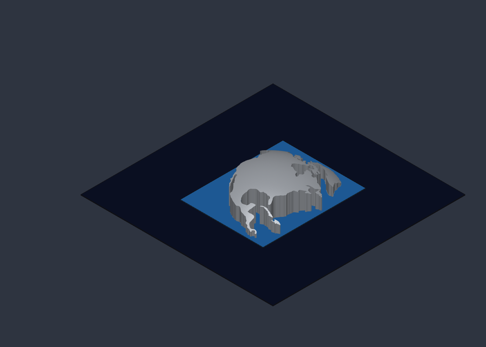

# North America on an Earth-curvature dome (K = 2.464 × 10⁻¹⁴ m⁻²)

### 🌐 [Open the 3D model (rotate freely in the browser)](NorthAmerica_EarthDome_K2.464.stl)

A physical companion to the [report](../README.md). The report measures Earth's Gaussian curvature from surveyors' triangles: **K = 2.450 ± 0.012 × 10⁻¹⁴ m⁻²** (radius 6 389 km). This model builds the continent on a surface whose curvature is set to Earth's mean value, **K = 1/R² with R = 6 371 km, so K = 2.464 × 10⁻¹⁴ m⁻²**. That value is within the report's error bars (+1.2σ) and 0.1% from the ellipsoid value 1/(MN) = 2.462 × 10⁻¹⁴ m⁻² over the same triangles.

## What it is

| Item | Value |
| --- | --- |
| Scale | 1 : 1 000 000 (1 mm = 1 km) |
| Sphere radius in the model | 6 371 mm, so K = 2.464 × 10⁻⁸ mm⁻² |
| Projection centre | 45° N, 100° W |
| Coastline | Natural Earth 1:50m, lightly averaged (inlets and capes under ~25 km rounded off) |
| Landmasses | Mainland (Alaska to Panama), Greenland, Baffin, Victoria, Ellesmere, Banks, Devon, Newfoundland, Cuba, Hispaniola |
| Top surface | Flat triangles about 100 km on a side; every vertex lies exactly on the sphere |
| Height | Peak 1 934 mm above the base (near the projection centre); lowest coastline point 50 mm (far side of Greenland) |
| Base | Flat at z = 0, with vertical walls along the coast |
| Ocean layer | 6 900 × 8 550 × 50 mm, z = −50 to 0 |
| Star layer | 16 000 × 16 000 × 50 mm, z = −100 to −50 |

The coastline is placed where it sits on the sphere, not on a flat map: points are laid out by distance along the surface from the centre (azimuthal equidistant) and lifted onto the sphere. The 1.9 m rise across the model is Earth's curvature at this scale. Across North America the surface drops about 1 900 km below a plane touching it at the centre.

## The faceted top as a Theorema Egregium check

Each flat triangle has zero curvature inside it. All the curvature sits at the corners, as an **angle deficit**: 2π minus the sum of the angles meeting at a vertex. This is the same rule the report uses for survey triangles (angle excess = K × area), turned around.

| Check on the model's top surface | Value |
| --- | --- |
| Interior vertices | 2 416 |
| Total angle deficit | 0.508 46 rad (104 878″) |
| Area belonging to those vertices | 20 625 339 mm² |
| K from deficit ÷ area | 2.465 × 10⁻⁸ mm⁻² |
| 1/R² | 2.464 × 10⁻⁸ mm⁻² |
| Ratio | **1.0006** |

The angles alone, measured inside the faceted surface, give back the sphere's curvature. That is Gauss's result on a small scale.

## Star map

The star layer carries a star chart as a decal (in the SolidCraft file only; an STL holds shape, not images). It is centred on the north celestial pole and shown as seen looking up from inside the sky, so it reads mirror-imaged from above. Stars are the ~5 000 brighter than magnitude 6 from the Yale Bright Star Catalogue (via [d3-celestial](https://github.com/ofrohn/d3-celestial)), sized by magnitude and coloured by B−V, with constellation lines and an RA/Dec grid. Image: [`starmap.jpg`](starmap.jpg).

## Files

| File | What it is |
| --- | --- |
| [`NorthAmerica_EarthDome_K2.464.stl`](NorthAmerica_EarthDome_K2.464.stl) | All 12 bodies, mm, binary STL. GitHub shows it in a 3D viewer |
| [`NorthAmerica_EarthDome_K2.464.solidcraft`](NorthAmerica_EarthDome_K2.464.solidcraft) | SolidCraft design: the 10 land meshes, the ocean and star slabs with colours, the star-map decal, and `ocean_thickness` / `star_thickness` parameters |
| [`na_dome_mesh.py`](na_dome_mesh.py) | Rebuilds the land meshes. `--tri` sets triangle size in km, `--base` the lowest coast height in mm. Needs Natural Earth `ne_50m_admin_0_countries.geojson` |
| [`starmap.jpg`](starmap.jpg) | The star chart image (4096 × 4096) |
| `preview_*.png` | Renders from SolidCraft |
