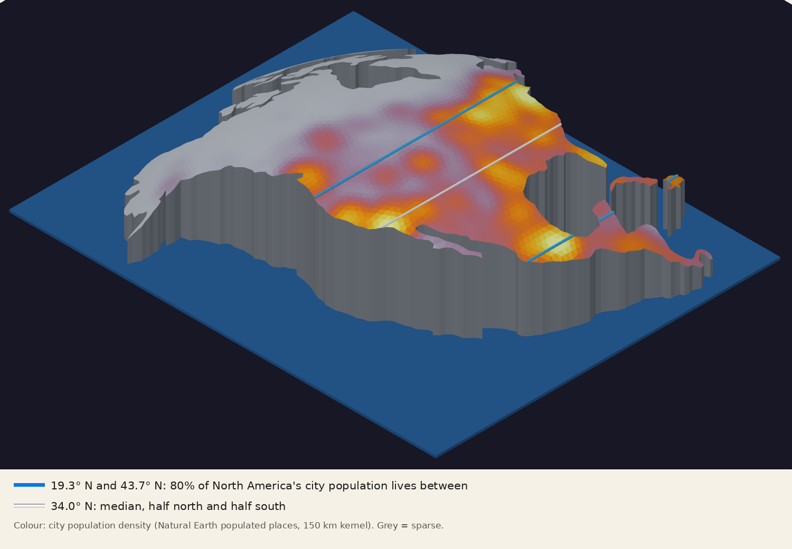
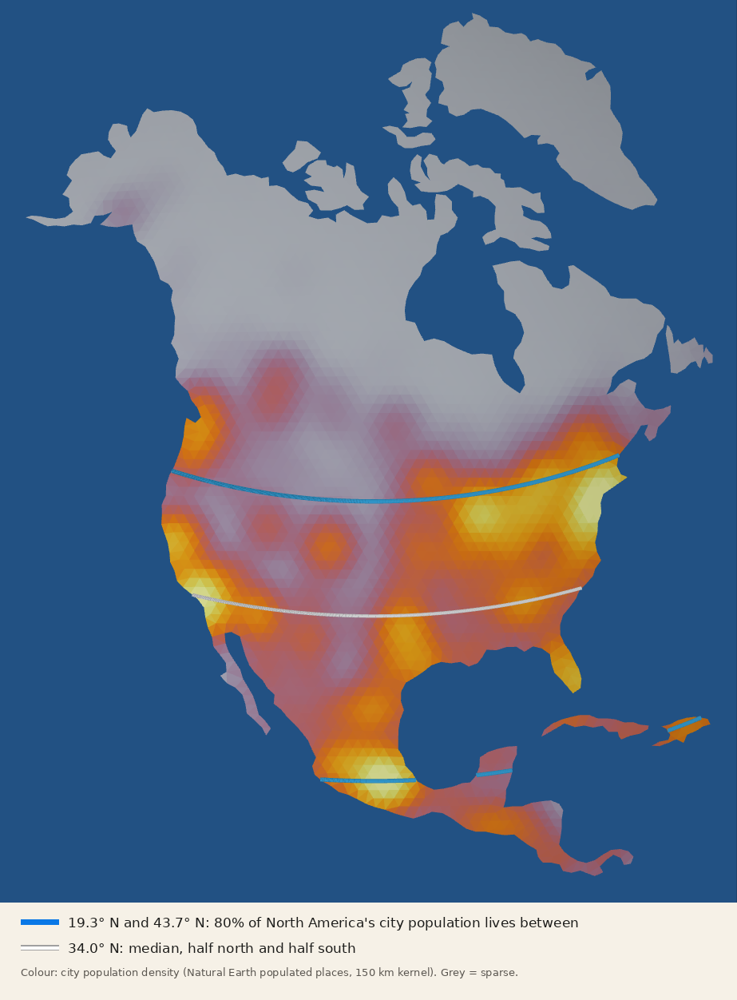

# North America on the measured curvature (K = 2.450 × 10⁻¹⁴ m⁻²)

## 📄 [Read the model page, with the rotatable 3D viewer](https://rooster-ninja.github.io/TheoremaEgregium_CurvatureMeasuredFromSurveyorsTriangles/model/)

Also: [STL in GitHub's 3D viewer](NorthAmerica_EarthDome_K2.450.stl)

A physical companion to the [report](../README.md). The report measures the Earth's Gaussian curvature from the angles of 391 surveyors' triangles, using only angles and ground lengths: **K = 2.450 ± 0.012 × 10⁻¹⁴ m⁻²** (± 0.019 with survey-to-survey scatter). This model builds North America on a sphere with **that measured curvature**: R = 1/√K = 6 388.8 km (1σ 6 373–6 404 km), scaled 1 : 1 000 000.

For comparison only: the ellipsoid's 1/(MN) over the same triangles is 2.462 × 10⁻¹⁴ m⁻² (measured/ellipsoid = 0.995 ± 0.005), and a sphere of the 6 371 km mean radius has 2.464 × 10⁻¹⁴ m⁻².

## What it is

| Item | Value |
| --- | --- |
| Curvature K (set) | 2.450 × 10⁻¹⁴ m⁻², measured in the [report](../README.md) |
| Scale | 1 : 1 000 000 (1 mm = 1 km) |
| Sphere radius in the model | 6 388.8 mm (K = 2.450 × 10⁻⁸ mm⁻²) |
| Projection centre | 45° N, 100° W |
| Coastline | Natural Earth 1:50m, lightly averaged (inlets and capes under ~25 km rounded off) |
| Landmasses | Mainland (Alaska to Panama), Greenland, Baffin, Victoria, Ellesmere, Banks, Devon, Newfoundland, Cuba, Hispaniola |
| Top surface | Flat triangles about 100 km on a side; every vertex lies exactly on the sphere |
| Height | Peak 1 938 mm above the base (near the projection centre); lowest coastline point 50 mm (far side of Greenland) |
| Mainland footprint | 6 077 × 7 199 mm |
| Base | Flat at z = 0, with vertical walls along the coast |
| Ocean layer | 6 900 × 8 600 × 50 mm, z = −50 to 0 |
| Star plane | A single plane at z = −50 mm, drawn as a disc 80 m across (a circle of infinite radius, K = 0) |

Coastline points are laid out by distance along the surface from the centre (azimuthal equidistant) and lifted onto the sphere.

**Why the measured K changes the size, not the shape.** The coastline is placed by latitude and longitude, which are angles. On a sphere, distance along the surface = radius × angle, so the continent's size comes from the sphere's size. The measured K (2.450 × 10⁻¹⁴ m⁻²) gives a radius of 6 388.8 km, 0.28% larger than the 6 371 km mean radius. The same angles on a larger sphere make the whole model 0.28% larger: wider, longer, and taller at the peak (1 938 mm instead of 1 934). The shape is identical, because all spheres are the same shape at different sizes. With the coastline fixed by angles, K changes only the model's overall size, not its proportions.

## The faceted top as a Theorema Egregium check

Each flat triangle has zero curvature inside it. All the curvature sits at the corners, as an **angle deficit**: 2π minus the angles meeting at a vertex. It is the report's rule (angle excess = K × area) turned around.

| Check on the model's top surface | Value |
| --- | --- |
| Interior vertices | 2 423 |
| Total angle deficit | 0.508 01 rad (104 784″) |
| Area belonging to those vertices | 20 720 084 mm² |
| K from deficit ÷ area | 2.4518 × 10⁻⁸ mm⁻² |
| K set (report's measured value) | 2.4500 × 10⁻⁸ mm⁻² |
| Ratio | **1.0007** |

Output: [`deficit_check.json`](deficit_check.json), from [`check_deficit.py`](check_deficit.py).

## Where people live on the surface

80% of North America's city population lives between 19.3° N and 43.7° N (median 34.0° N). Worldwide, half of all city population lives between 13.1° N and 39.0° N (median 29.6° N), and 85% north of the equator. City populations only (Natural Earth populated places, `pop_max`); rural populations are not counted. Built by [`pop_scene.py`](pop_scene.py).

## The star plane: a circle of infinite radius

The sky is drawn as a single flat plane under the ocean. A circle of radius r curves by 1/r and a sphere of radius R has K = 1/R²; as the radius grows without limit both go to zero, so a circle of infinite radius is a line and a sphere of infinite radius is a plane (K = 0).

The chart is a stereographic projection of the celestial sphere from the south celestial pole, r = 2 tan((90° − δ)/2): the north celestial pole is at the centre, the celestial equator at r = 2, and the south pole at infinity. It is drawn to δ = −45° on a disc 80 m across at z = −50 mm and fades out from −15° to the edge. Seen from inside the sky, so it reads mirror-imaged from above. Stars: the ~5 000 brighter than magnitude 6 in the Yale Bright Star Catalogue (via [d3-celestial](https://github.com/ofrohn/d3-celestial)). Image: [`starplane.png`](starplane.png). The STL doesn't include it (STL holds shape, not images); the model page and the SolidCraft file do.

## Files

| File | What it is |
| --- | --- |
| [`NorthAmerica_EarthDome_K2.450.stl`](NorthAmerica_EarthDome_K2.450.stl) | The 10 landmasses and the ocean slab, mm, binary STL. GitHub shows it in a 3D viewer |
| [`NorthAmerica_EarthDome_K2.450.solidcraft`](NorthAmerica_EarthDome_K2.450.solidcraft) | SolidCraft design: the 10 land meshes, the ocean slab, the star plane as an image canvas at z = −50 mm, `ocean_thickness`, and `K_measured` (with its source in the comment) |
| [`na_dome_mesh.py`](na_dome_mesh.py) | Rebuilds the land. `--K` curvature (default 2.450e-14 m⁻², the report's value), `--tri` triangle size in km, `--base` lowest coast height in mm, `--stl_dir` one STL per landmass |
| [`mesh_params.json`](mesh_params.json) | K, R, lift and triangle size for this build |
| [`check_deficit.py`](check_deficit.py), [`deficit_check.json`](deficit_check.json) | The angle-deficit check and its output |
| [`pop_scene.py`](pop_scene.py) | Population colouring and latitude bands |
| [`starplane.png`](starplane.png), [`starplane.py`](starplane.py) | The stereographic star plane and the script that draws it |
| [`index.html`](index.html) | The model page (GitHub Pages) |
| `population_iso.png`, `population_top.png`, `preview_*.png` | Population figures and SolidCraft renders |
